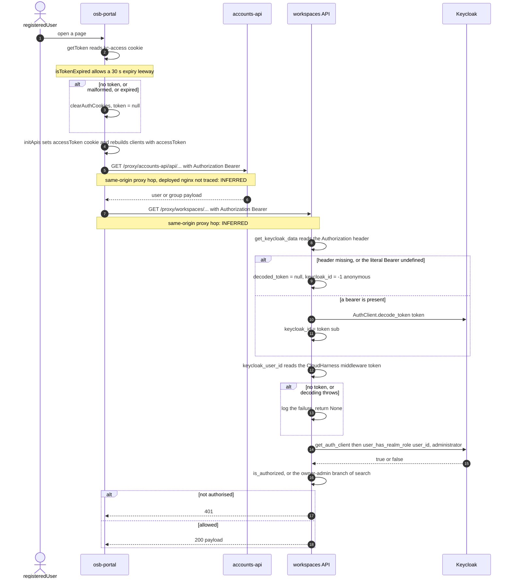

# Authenticated request

How one browser request acquires an identity in OSBv2 and what the workspaces API does with
it, from the `kc-access` cookie to a `user_has_realm_role` answer. Participants are the
Level 2 containers of `devdocs/system/c4-level2-osb-containers.md`, aliased to the same names
the L3 component diagrams reuse; the per-layer rules and failure modes are in
`devdocs/auth-model.md`.

The one hop this repository does not show end to end is the deployed proxy in front of the
frontends: the dev server's `server.proxy` is tracked, the production `location` /
`proxy_pass` is not, so that edge is marked **INFERRED** below.

## Hop table

| # | Hop | Source (file : symbol / line) | Evidence |
| --- | --- | --- | --- |
| 1 | Cookie → bearer token | `applications/osb-portal/src/service/UserService.tsx` : `getToken` (`:130-151`), `isTokenExpired` (`:102-109`), `TOKEN_EXPIRY_LEEWAY_SECONDS` (`:18`), `parseJwt` (`:111-128`) | solid — reads `kc-access`, decodes locally, clears cookies on a bad/expired token |
| 2 | Token → API clients | same file : `initApis` (`:32-49`), `accessToken` cookie (`:38`), `new Configuration({ basePath, accessToken })` (`:45-47`), `accountsApiUri` (`:12`) | solid |
| 3 | Login round-trip (context) | same file : `login` (`:159-183`, `window.location.href = "/login"`), `popLoginRedirect` (`:187-198`), `logout` (`:216-232`), `getKeycloakLogoutUrl` (`:201-214`) | solid — the browser hands over to the gatekeeper for `/login` and `/oauth/logout` |
| 4 | portal → accounts-api | `applications/osb-portal/vite.config.ts` : `server.proxy['/proxy/accounts-api']` (`:35-40`) | **INFERRED** for the deployment: the tracked proxy is the Vite dev server; the production `location` / `proxy_pass` is not in this repository. Backoffice's `nginxProxy` serving `/proxy/accounts-api/api` and `/proxy/workspaces/api` is documented in `devdocs/system/c4-level3-backoffice-components.md` and is the same shape, but is not code evidence for the portal |
| 5 | portal → workspaces API | `applications/osb-portal/vite.config.ts` : `server.proxy['/proxy/workspaces']` (`:29-34`); workspaces client wired in `UserService.tsx:42-44` | **INFERRED** for the deployment, as hop 4 |
| 6 | Bearer read, and the anonymous branch | `applications/workspaces/server/workspaces/utils.py` : `get_keycloak_data` (`:11-21`); missing header or `"Bearer undefined"` → `decoded_token = None`, `keycloak_id = -1` (`:14-16`); otherwise `AuthClient.decode_token(token)` and `decoded_token["sub"]` (`:18-20`) | solid — anonymous is a value (`-1`), not an error |
| 7 | Identity from the middleware | `applications/workspaces/server/workspaces/service/auth.py` : `keycloak_user_id` (`:27-36`), `get_authentication_token` import (`:6`), `AuthClient.decode_token(...).get("sub")` (`:33`) | solid — and note the second sentinel: missing/undecodable gives `None`, not `-1` |
| 8 | Keycloak client construction | same file : `get_auth_client` (`:16-24`) | solid — caches `_auth_client`; on failure raises `Exception("Keycloak not available")` (`:22-23`), a bare exception that becomes a 500 |
| 9 | Role check in authorisation | `applications/workspaces/server/workspaces/service/crud_service.py` : `WorkspaceService.is_authorized` (`:329-333`), `search` owner/admin filtering (`:335-363`), `VolumestorageService.is_authorized` (`:516-518`), `WorkspaceresourceService.is_authorized` (`:590-596`) | solid — every non-public, non-owned path costs a Keycloak round-trip |
| 10 | Controller gates and status codes | `workspaces/controllers/admin_controller.py` (`:10-13`), `workspaces/controllers/workspace_controller.py` (`:127-131`), `workspaces/controllers/workspace_run_controller.py` : `_owned_workspace` (`:78-89`) | solid — 401 for a missing identity or failed permission; `_owned_workspace` deliberately does not reuse `is_authorized` because that would let a reader of a public workspace start a run |
| 11 | UI-only admin flag | `applications/osb-portal/src/service/UserService.tsx` : `mapKeycloakUser` sets `isAdmin` from `realm_access.roles` (`:51-60`), used by `canEditWorkspace` / `canEditRepository` (`:234-240`) | solid — display only; enforcement is hop 9 |

## Things this diagram deliberately does not claim

- **The deployed proxy's internals.** Hop 4/5 are marked INFERRED. The tracked Vite config
  is a development server; the backoffice `nginx.conf` / `entrypoint.sh` pair is named in the
  L3 architecture document but was not opened to build this diagram.
- **A 401 from the deployment's ingress.** CloudHarness applies `uri_role_mapping` at the
  platform level (`devdocs/api-contracts.md`), which can reject a call before any handler in
  this diagram runs; the diagram shows only the rules implemented in the services' code.
- **Any role check that is not `administrator`.** `check_max_num_workspaces_per_user` tests
  `role="admin"` (`crud_service.py:191`) while every other check in the server tests
  `administrator`; the diagram follows the `administrator` path and does not model the quota
  check, which is a separate concern (see `devdocs/user-quotas.md`).
- **Keycloak's own behaviour.** Token issuance, refresh and signature verification happen
  inside the `accounts` / Keycloak container; the code here only decodes and asks.
