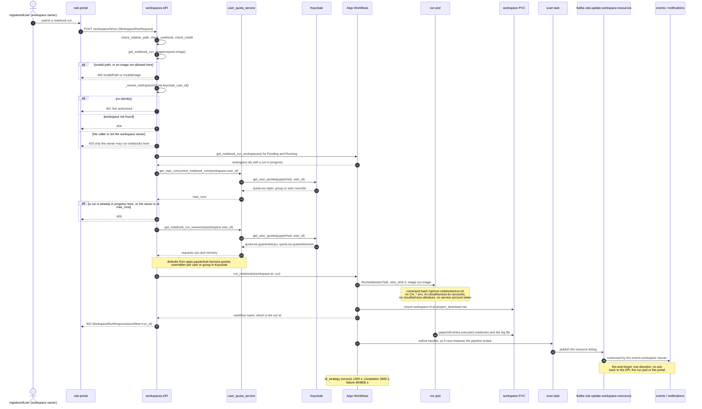

# Notebook run submission

How a notebook run goes from a portal request to an Argo pod, how its resources are sized
and how its results come back onto the workspace volume. Every hop is traced to a file and
symbol in this repository; the events branch is drawn as what it is in the code --
one-directional and unacknowledged -- and anything the code does not show is marked
`INFERRED` rather than drawn as fact.

Source of the diagram: the fenced `mermaid` block below.
`devdocs/scripts/render_mermaid.py` renders it with `mmdc`; a render is successful when the
CLI exits 0. `layout: elk` is omitted because these documents are `sequenceDiagram`s, which
reject it (see `devdocs/flows/README.md`).

## Hop table

| # | Hop | Source (file : symbol / line) | Evidence |
| --- | --- | --- | --- |
| 1 | `POST /workspace/{id}/run` handler | `applications/workspaces/server/workspaces/controllers/workspace_run_controller.py` : `run_notebooks` (`:106-145`), route named in its docstring (`:107`) | solid -- returns `WorkspaceRunResponse(workflow=run_id), 202` (`:145`) |
| 2 | Request validation | same file : `check_relative_path` (`:23-33`), `check_notebook` (`:36-40`), `check_install` (`:43-47`), the `run` dict build (`:110-129`), `except (InvalidPath, InvalidImage)` -> `str(exc), 400` (`:130-131`) | solid -- paths must stay inside the volume and `repo.dir` must name a folder (`:127-129`); `notebooks` must list at least one `.ipynb` (`:123-124`) |
| 3 | Image resolution | same file : `DEFAULT_NOTEBOOK_RUN_IMAGE` / `MINIMAL_NOTEBOOK_RUN_IMAGE` (`:50-53`), `get_notebook_run_image_registries` (`:56-60`), `get_notebook_run_image` (`:63-75`) | solid -- without a request, `jupyterlab` if deployed else `jupyterlab-minimal` (`:67-69`); a requested image must be a deployed `harness__jupyterhub` app or sit under a configured `notebook_run_image_registries` prefix, else `InvalidImage` (`:70-75`) |
| 4 | Ownership gate | same file : `_owned_workspace` (`:78-89`) | solid -- 401 on no `keycloak_user_id()`, 404 if missing, 403 if `workspace.user_id != user_id`; its docstring states it deliberately does **not** reuse `WorkspaceService.is_authorized`, which would let any reader of a public workspace start a run |
| 5 | Concurrency guard | same file : `_concurrent_runs_error` (`:92-103`) | solid -- 409 when this workspace already runs (`:95-97`) or its owner is at `get_max_concurrent_notebook_runs` (`:100-102`); the running set comes from Argo, not the database |
| 6 | Running-set query | `applications/workspaces/server/workspaces/service/workflow.py` : `get_notebook_run_workspaces` (`:186-196`) | solid -- lists `Pending` then `Running` workflows (`limit=9999`), keeps names starting `osb-run-notebooks-job`, parses the `workspace` label; a run submitted a moment ago may not be listed yet (docstring `:187-188`), so the guard is best-effort |
| 7 | Concurrent-run quota | `applications/workspaces/server/workspaces/service/user_quota_service.py` : `get_max_concurrent_notebook_runs` (imported `workspace_run_controller.py:12`, called `:100`) | solid -- quota read from `jupyterhub` configuration; the value is `quota-ws-open` in `applications/workspaces/server/test/values.yaml` (`apps.jupyterhub.harness.quotas`, default `3`) |
| 8 | Run resource sizing | `user_quota_service.py` : `get_notebook_run_resources` (`:24-29`); called at `workspace_run_controller.py:139-140` | solid -- `get_user_quotas(get_configuration('jupyterhub'), user_id=user_id)` (`:27`) then `requests.cpu = quota-ws-guaranteecpu` and `requests.memory = {quota-ws-guaranteemem}G`; docstring: "A notebook run's pod gets what the user's lab pod gets: jupyterhub's CPU/memory quotas (deployment defaults, overridden per user or group in Keycloak)" (`:25-26`) |
| 9 | Quota defaults | `applications/workspaces/server/test/values.yaml` : `apps.jupyterhub.harness.quotas` (`quota-storage-max: 1.25`, `quota-ws-guaranteecpu: 0.2`, `quota-ws-guaranteemem: 0.5`, `quota-ws-maxcpu: 1`, `quota-ws-maxmem: 1`, `quota-ws-open: 3`); sizing rules in `devdocs/user-quotas.md` | solid -- the same block the workspaces server reads back with `get_configuration('jupyterhub')` |
| 10 | Run submission | `workflow.py` : `run_notebooks` (`:199-235`) | solid -- builds the `env` map, one path per line for lists (`:203-215`), then `RunNotebooksTask(...)` and `RunNotebooksPipeline(...)`, returning `op.execute().name` (`:235`), i.e. the run id **is** the workflow name |
| 11 | The run pod's task | `workflow.py` : `RunNotebooksTask` (`:157-173`), instantiated (`:216-224`) | solid -- `retry_limit=0` with the comment "notebooks aren't safe to re-run blindly" (`:220`), `resources=run["resources"]` (`:221`), `run_id="{{workflow.name}}"` (`:222`), `command=["bash", "/opt/run-notebooks/run.sh"]` (`:219`), image from `run["image"]` (`:218`) |
| 12 | Secret and token stripping | `workflow.py` : `cloudharness_configmap_spec` (`:160-166`) and the `envs` property (`:169-173`) | solid -- filters `cloudharness-kc-accounts` and `cloudharness-allvalues` out of the mounts, mounts `run-notebooks-script` read-only, mounts an empty dir over `/var/run/secrets/kubernetes.io/serviceaccount` (`SERVICE_ACCOUNT_TOKEN_DIR`, `:135`), and drops every env whose name starts with `CH_`. The comment names the reason: third-party repository code can read run.sh's environment via `/proc` (`:158-159`, `:170-172`) |
| 13 | Script delivery | `workflow.py` : `RUN_NOTEBOOKS_SCRIPT_CONFIGMAP = "workspaces-run-notebooks"` (`:131`), `RUN_NOTEBOOKS_SCRIPT_DIR` (`:132`), `RunNotebooksPipeline.spec` adding the configMap volume (`:178-183`) | solid -- the source is `applications/workspaces/deploy/templates/run-notebook-configmap.yaml` per the comment at `:127` |
| 14 | Exit-handler scan | `workflow.py` : `PipelineScannedOnExit` (`:138-154`), used by `RunNotebooksPipeline` (`:176-183`) with `scan_task=create_scan_task(workspace_id)` (`:230`) | solid -- `task_list` lists the scan task so its template gets the shared directory (`:146-149`) and `spec` sets `spec["onExit"]` (`:151-154`), so the rescan runs however the pipeline ended (docstring `:139-140`) |
| 15 | Scan task and queue | `workflow.py` : `create_scan_task` (`:85-91`) publishing to `events.UPDATE_WORKSPACES_RESOURCE_QUEUE`; destination in `workspaces/controllers/events.py` : `UPDATE_WORKSPACES_RESOURCE_QUEUE = "osb-update-workspace-resources"` (`:9`), handler `update_workspace_resources` (`:12-27`), consumer `start_kafka_consumers` (`:30-36`) | solid -- the scan writes to the volume and publishes; the **consumer** rewrites the resource rows. This is the events branch drawn above |
| 16 | Fire-and-forget nature | `workspaces/controllers/events.py` (`:12-36`) and `workflow.py` (`:225-235`) | solid, by absence: `run_notebooks` returns immediately with the workflow name (`:235`) and nothing reads the scan's outcome back; there is no callback, ack or returned message id on the run path. The API and the portal never learn whether the rescan succeeded |
| 17 | Retention of the run record | `workflow.py` : `ttl_strategy` (`:17-21`) | solid -- `secondsAfterSuccess: 1200`, `secondsAfterCompletion: 3600`, `secondsAfterFailure: 604800`; once Argo collects the workflow only its side effects remain (see `devdocs/data-model.md`) |
| 18 | `@send_event` on the platform | `applications/workspaces/server/workspaces/service/crud_service.py` : `post` (`:211`), `clone` (`:305`), `OsbrepositoryService.post` (`:473`) | solid -- these are the only `send_event` uses in the workspaces server (`grep send_event`) and **none is on the run path**, so a run does not emit a workspace event; only the scan's queue message covers it |

## What this flow deliberately does not claim

- **A notifications consumer for runs.** `grep` for `subscribe|topic|queue|message_type|send_event`
  over `applications/notifications` returns no matches, so the `events -> notifications` hop is
  drawn as the platform's events component in general, not as a verified run-notification.
  Treat a user-visible "your run finished" notification as **INFERRED** and unproven.
- **The content of `run.sh`.** It is delivered from the `workspaces-run-notebooks` ConfigMap, but
  the script body was not read for this diagram; the diagram shows only that the pod executes it
  with papermill-style side effects on the volume (the executed notebooks and the log file the
  request names).
- **Argo's own scheduling.** Queueing, retries of the wait container and pod placement are Argo's
  behaviour; `retry_limit=0` constrains the run container only.
- **A 401 from the deployment's ingress.** CloudHarness `uri_role_mapping` can reject a request
  before the handler runs (`devdocs/api-contracts.md`); the diagram shows only the checks in
  `workspace_run_controller.py`.
- **Volume readiness on this path.** The run mounts `workspace-N` (`workflow.py:231`) but the
  blocking ready check (`ensure_volume_ready`, `crud_service.py:282-303`) is on the workspace-open
  path, not here; a run on an unbound volume is not guarded by this controller.

## Related documents

- `devdocs/auth-model.md` -- the identity and role rules behind hops 4 and 5.
- `devdocs/data-model.md` -- why a run lives in Argo and not in Postgres.
- `devdocs/user-quotas.md` -- where the quota numbers in hops 7-9 come from.
- `devdocs/flows/sequence-workspace-import.md` -- the same scan/queue machinery on the import path.
