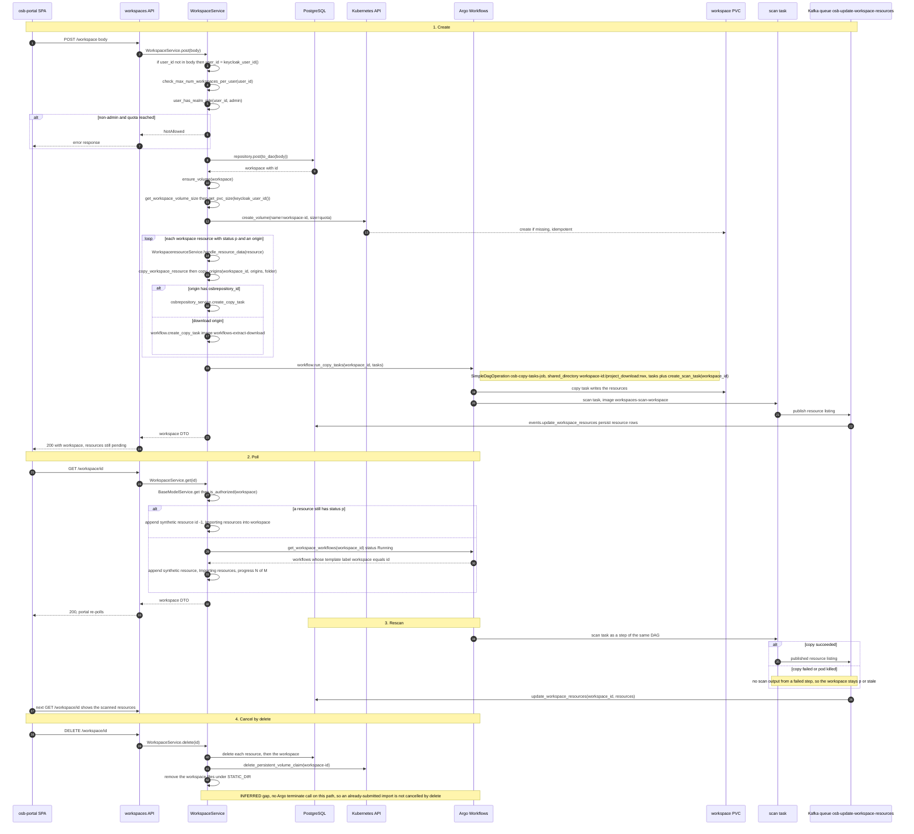

# Workspace import flow

How a workspace is created, how its resources are copied onto its volume, how the
portal polls until the copy finishes, and what happens when the workspace is deleted
mid-import. Every hop below is traced to a file and symbol in this repository; where a
step is **not** evidenced by the code it is marked `INFERRED` and called out rather
than drawn as fact.

Source of the diagram: the fenced `mermaid` block below. `devdocs/scripts/render_mermaid.py`
renders it with `mmdc`; a render is successful when the CLI exits 0.

## Hop table

| # | Hop | Evidence (file:symbol / line) | Notes |
| --- | --- | --- | --- |
| 1 | SPA -> API `POST /workspace` | `applications/workspaces/api/openapi.yaml` (route/collection), handler reached through `applications/workspaces/server/workspaces/controllers/workspace_controller.py` | The sibling run route is documented as `POST /workspace/{id}/run` (`workspace_run_controller.py:107`), which fixes the collection style. |
| 2 | API -> `WorkspaceService.post` | `applications/workspaces/server/workspaces/service/crud_service.py:211-224` | Decorated `@send_event(message_type="workspace", operation="create")`, so creation also emits a Kafka workspace event. |
| 3 | default `user_id` | `crud_service.py:213-214` | `body['user_id'] = keycloak_user_id()` only when absent. |
| 4 | quota check | `crud_service.py:186-199` (`check_max_num_workspaces_per_user`) | Searches the user's workspaces (`repository.search(user_id=...).total`) against `get_max_workspaces_for_user` (`workspaces/service/user_quota_service.py`), raising `NotAllowed` past the limit. It gates on `role="admin"` (`:191`) while every other check uses `role="administrator"` -- see the inconsistency noted in `devdocs/auth-model.md`. |
| 5 | DB insert | `crud_service.py:217`, `BaseModelService.post` at `:132-136` | `to_dao` validates through the model (`WorkspaceService.to_dao`, `:378-387`) and resolves tags. |
| 6 | volume sizing | `crud_service.py:230-244` (`get_workspace_volume_size`, `ensure_volume`), `workspaces/service/user_quota_service.py` (`get_pvc_size`) | Sized from the **calling** user's quota, not the workspace owner's. `create_volume` is idempotent, so a migrated workspace without a volume is repaired here. |
| 7 | per-resource dispatch | `crud_service.py:221-222`, `workspaces/helpers/etl_helpers.py:48-53` (`copy_workspace_resource`), `:15-45` (`copy_origins`) | Only resources with `status == ResourceStatus.P` and an `origin` are copied (`etl_helpers.py:49`). |
| 8 | OSB-repository origin | `etl_helpers.py:20-34` -> `osbrepository_service.create_copy_task` (`workspaces/service/osbrepository.py`) | Uses `origins[0].osbrepository_id`; the result may be a task or a list of tasks. |
| 9 | download origin | `etl_helpers.py:35-44` -> `workflow.create_copy_task` (`workspaces/service/workflow.py:75-82`) | Default image is `workflows-extract-download`; folder is the resource's parent folder (`etl_helpers.py:56-61`). |
| 10 | workflow submission | `workspaces/service/workflow.py:48-60` (`run_copy_tasks`) | `SimpleDagOperation("osb-copy-tasks-job", tasks, (create_scan_task(workspace_id),), shared_directory="<pvc>:/project_download:rwx", pod_context=PodExecutionContext("workspace", workspace_id, required=True))`. |
| 11 | scan task | `workflow.py:63-72` (`create_task`), `:85-91` (`create_scan_task`) | Image `workspaces-scan-workspace`, `queue=events.UPDATE_WORKSPACES_RESOURCE_QUEUE`. |
| 12 | scan consumer | `applications/workspaces/server/workspaces/controllers/events.py:8-9`, `:12-27` (`update_workspace_resources`, `_consumer_queues`), `:30-36` (`start_kafka_consumers`) | Queue name is `osb-update-workspace-resources`, group `workspaces`; the handler strips the `/project_download/` mount prefix before persisting (`events.py:15-17`). |
| 13 | polling read | `crud_service.py:389-439` (`WorkspaceService.get`), `:138-143` (`BaseModelService.get`) | `is_authorized` is evaluated twice: in `BaseModelService.get` and again in `WorkspaceService.get`. |
| 14 | pending resource | `crud_service.py:395-406` | Any resource with `ResourceStatus.P` short-circuits to a synthetic `id: -1` resource named "Importing resources into workspace". |
| 15 | running-workflow progress | `crud_service.py:408-437` -> `:201-209` (`get_workspace_workflows`) | Lists Argo workflows with `status="Running", limit=9999` and keeps those whose `spec.templates[0].metadata.labels["workspace"]` equals the workspace id; the synthetic resource reads `workflow.raw.status.progress` and replaces `/` with " of " (`:414-415`). Attribute errors are swallowed so a non-import workflow does not fail the read (`:428-437`). |
| 16 | rescan on success | `workflow.py:48-60` + `events.py:12-27` | The scan is a normal step of the copy DAG, so it runs after the copy tasks succeed. |
| 17 | rescan on failure / kill | **INFERRED gap**: `run_copy_tasks` (`workflow.py:48-60`) uses `SimpleDagOperation`, not an `onExit` handler | The exit-handler variant exists only for notebook runs (`PipelineScannedOnExit`, `workflow.py:138-154`, used by `RunNotebooksPipeline`, `:176-183`, `:225-234`). For workspace import, a failed copy step therefore produces no scan output and statuses can stay `p`; treat the failed-import rescan as unverified, not as designed behaviour. |
| 18 | cancel by delete | `crud_service.py:445-464` (`WorkspaceService.delete`) | Deletes each workspace resource (`:449-452`), the workspace row (`:454`), the PVC via `delete_persistent_volume_claim(f"workspace-{id}")` (`:457`) and the static folder (`:460-464`). |
| 19 | cancellation of a running import | **INFERRED gap**: no Argo terminate/delete call appears in `WorkspaceService.delete` or anywhere in `workspaces/service/workflow.py` (235 lines, read in full) | Cancelling a running import workflow is not implemented on the delete path as far as this repository's code shows; do not document a `delete_workflow` hop without a symbol to cite. |

## Notes on the edges of this flow

- **Two "anonymous" sentinels.** The import flow is owner-scoped (the resources belong to
the workspace), but the identity helpers differ: `workspaces/utils.py:11-21`
(`get_keycloak_data`) yields `keycloak_id = -1` with no bearer, while
`workspaces/service/auth.py:27-36` (`keycloak_user_id`) yields `None`. A workspace
created without a valid bearer therefore gets `user_id = None`.
- **Volume readiness is checked elsewhere.** The import path creates the PVC
(`ensure_volume`); the blocking "is it bound?" check is on the run path
(`ensure_volume_ready`, `crud_service.py:282-303`, surfaced as
`{"error": "volume_not_ready"}`, 503 by `workspace_controller.py:135-139`). Note that
503 is *not* an auth signal.
- **The event is emitted before the work is done.** `post` carries
`@send_event(message_type="workspace", operation="create")`, so the workspace-create
event fires around the same call that submits the copy workflow; consumers must not
assume the volume is already populated when they see it.
- **Polling cost.** Each poll of a workspace with no pending resource costs one Argo
list (`get_workflows(status="Running", limit=9999)`) plus one Keycloak role lookup in
`is_authorized` (for non-public, non-owned workspaces).
