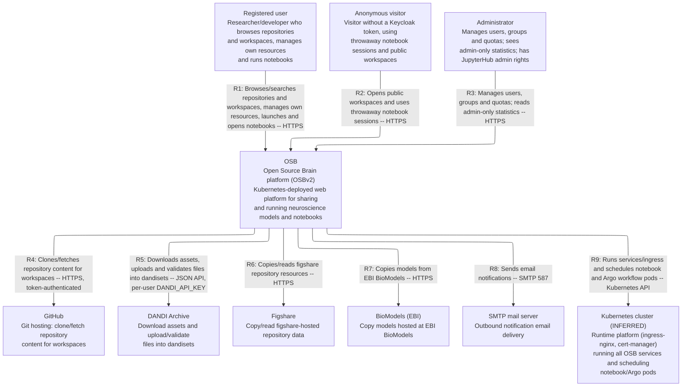

# C4 model: Level 1 -- System Context diagram

Status: architecture documentation. This is the C4 Level 1 view of the OSB
(Open Source Brain, OSBv2) platform, built from evidence in this repository
(README, Helm/deploy values, OpenAPI specs and task definitions) rather than
from assumption.  The Level 2 container view is in
`c4-level2-osb-containers.md`.

## Scope and intent

A system context diagram is the zoomed-out view: the software system in scope
drawn as a single box in the centre, surrounded by the people who use it and
the other software systems it interacts with.  Per the C4 standard
(https://c4model.com/diagrams/system-context) the focus is on people and
software systems, not technologies, protocols, or low-level detail.

The diagram is rendered as a Mermaid `flowchart` with `layout: elk` instead of
Mermaid's `C4Context`, following the convention of the sibling Klea project:
Mermaid's C4 diagram types use a fixed 2-column grid with straight `Rel` lines
that overlap boxes at this density, while `elk` routes edges orthogonally
around nodes.  This is a documentation-notation choice, not an architecture
decision.

Elements and relationships are unchanged from the previous `C4Context` source
(`c4-level1-osb-context.mmd`, now superseded by this file): the same 3
persons, the `OSB` system in scope, the same 6 external systems and the same
R1-R9 relationships with their protocol notes.

## System Context diagram -- OSB (flowchart, elk)

*Notes:* Solid `-->` = an evidenced runtime dependency.  The `kubernetes`
node is marked INFERRED both in its label and in the `%%` comment inside the
diagram: the Kubernetes cluster / ingress platform is inferred from
`deployment-configuration/values-template.yaml` (mainapp osb-portal, tls true)
and the nginx CORS ingress annotations in
`deployment-configuration/values-template-dev.yaml`.  Relationship labels keep
their original wording with the protocol note appended after `--`.
