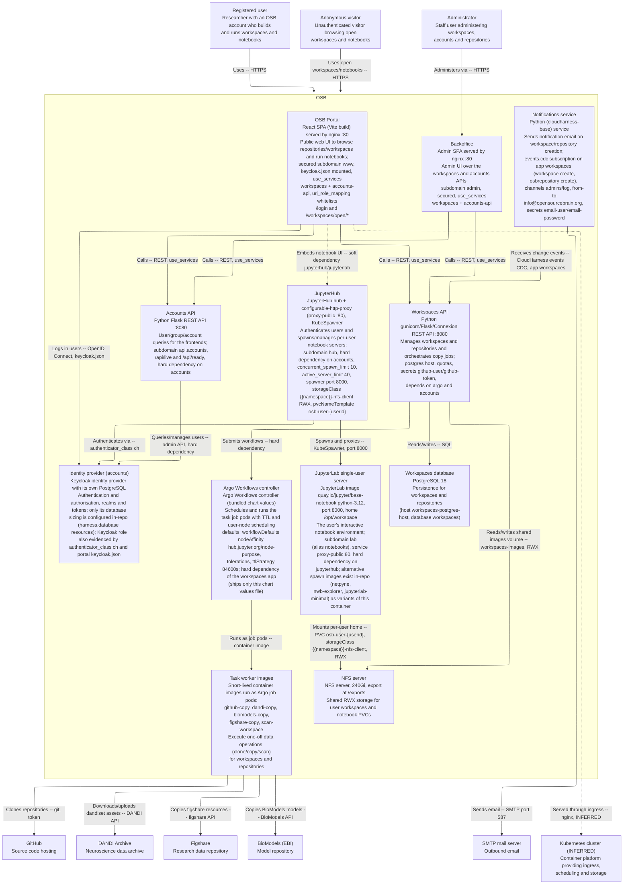

# C4 model: Level 2 -- Container diagram

Status: architecture documentation. This is the C4 Level 2 view of the OSB
(Open Source Brain, OSBv2) platform, built from evidence in this repository
(README, Helm/deploy values, OpenAPI specs and task definitions) rather than
from assumption.  The Level 1 system context is in
`c4-level1-osb-context.md`.

## Scope and intent

A container diagram zooms into the system in scope (OSB) and shows the
*containers* -- the independently deployable applications, services and
datastores -- plus how they interact with each other and how they connect to
the external systems from Level 1.  Per the C4 standard
(https://c4model.com/diagrams/container) containers are things that can be
deployed/run independently.

The diagram is rendered as a Mermaid `flowchart` with `layout: elk` instead of
Mermaid's `C4Container`, following the convention of the sibling Klea project:
Mermaid's C4 diagram types use a fixed 2-column grid with straight `Rel` lines
that overlap boxes at this density, while `elk` routes edges orthogonally
around nodes.  This is a documentation-notation choice, not an architecture
decision.

Elements and relationships are unchanged from the previous `C4Container`
source (`c4-level2-osb-containers.mmd`, now superseded by this file): the same
12 containers with their technology and responsibility text, the Level 1
persons and external systems, and the same labelled relationships.

## Container diagram -- OSB containers (flowchart, elk)

*Notes:* Solid `-->` = an evidenced runtime dependency; dotted `-.->` = a
soft/inferred link (`portal -> hub` soft dependency `jupyterhub/jupyterlab`,
`portal -> kubernetes` served through ingress and INFERRED).  The `kubernetes`
node is marked INFERRED both in its label and in the `%%` comment inside the
diagram (inferred from `deployment-configuration/values-template.yaml`
mainapp osb-portal with tls true, and the nginx CORS ingress annotations in
`deployment-configuration/values-template-dev.yaml`).  Per the `%%` OUT OF
SCOPE note, the `events` and `workflows` dependencies exist only as dependency
names (no directory under `applications/`), are upstream CloudHarness-provided
and are not modelled as containers; the event flow appears only as
`notifications <- wsapi` (CloudHarness events CDC).
