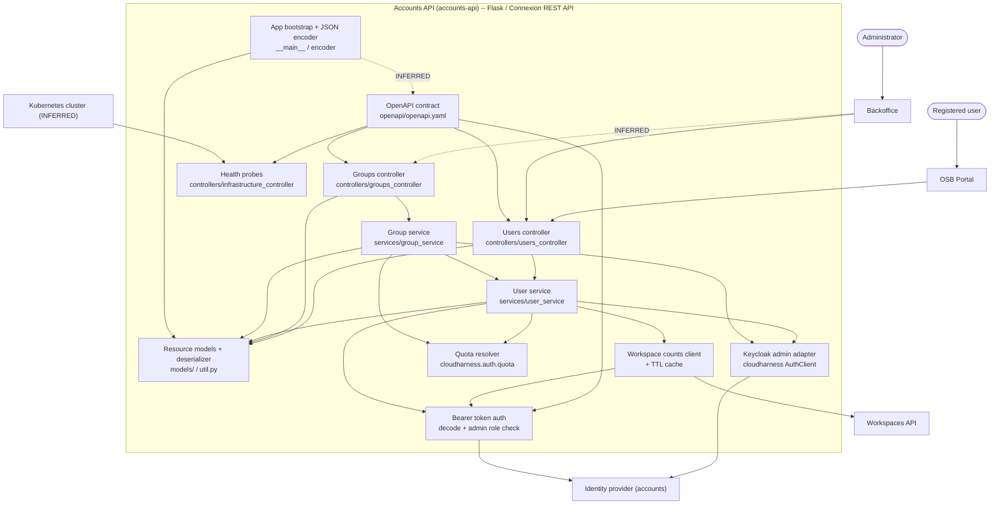

# C4 model: Level 3 -- Component diagram (Accounts API)

Status: architecture documentation. This is the C4 Level 3 view of one container
from the Level 2 model: the **Accounts API** (`accounts-api`), the Python
Flask/Connexion REST API that answers user and group queries for the frontends.
The Level 1 system context is in `c4-level1-osb-context.md`; the Level 2 container
diagram is in `c4-level2-osb-containers.md`.

## Scope and intent

A component diagram zooms into a single container and shows the *components* --
the groupings of code behind a clear responsibility -- plus their relationships
to each other and to the containers/external systems already named at Level 2.
Per the C4 standard (https://c4model.com/diagrams/component) these are things
like controllers, services and adapters, not independently deployable units.

Everything inside the `accounts-api` boundary is evidenced by the code under
`applications/accounts-api/backend/accounts_api/` (`controllers/`, `services/`,
`models/`, `openapi/`): each box maps to real modules/classes, and each solid
relationship corresponds to an import or call actually present in that code.
Externals are the exact Level 2 identifiers, so this diagram cannot contradict
the container model.

The diagram is rendered as a Mermaid `flowchart` with `layout: elk` instead of
Mermaid's `C4Component`, following the convention of the sibling Klea project
and of the Level 1/2/3 files here: Mermaid's C4 diagram types use a fixed
2-column grid with straight `Rel` lines that overlap boxes at this density,
while `elk` routes edges orthogonally around nodes.  This is a
documentation-notation choice, not an architecture decision.

## Component diagram -- Accounts API components (flowchart, elk)



*Notes:* Solid `-->` = an evidenced runtime dependency (an import or call
observed in `applications/accounts-api/backend/accounts_api/`); dotted `-.->` =
a soft or inferred link.  The dashed links are:

- `appBootstrap -> openapiSpec` -- INFERRED: `init_flask` locates the packaged
  `openapi.yaml` by CloudHarness convention; the spec path is never passed
  explicitly in `__main__.py`.
- `backoffice -> groupsController` -- INFERRED: the `/groups` operations exist in
  the spec and are routed to `groups_controller`, but no in-repo client calling
  them was found; drawn dashed rather than asserted.

Other evidence decisions worth recording:

- `tokenAuth` (`get_authentication_token` + `AuthClient.decode_token` + the
  `administrator` realm-role check) is the scheme the spec actually names
  (`x-bearerInfoFunc: cloudharness.auth.decode_token`).  The generated
  `controllers/security_controller_.py:info_from_bearerAuth` stub returns a
  hard-coded `{'uid': 'user_id'}` and is *not* the scheme in use, so it is not
  modelled.
- `wsCountsClient -> wsapi` is the forward call to the Workspaces API
  `/api/user-resource-counts` endpoint, with the caller's bearer token forwarded
  and the result cached for a short TTL; the cache is gated on the caller's own
  admin role, hence `wsCountsClient -> tokenAuth` as well.  A direct
  `wsCountsClient -> keycloak` link is deliberately *not* drawn; identity is
  resolved through `tokenAuth`.
- `quotaResolver` (`get_user_quotas` / `get_group_quotas`) reads CloudHarness app
  configuration (`workspaces`, `jupyterhub`), which has no Level 2 node -- left
  unmodelled with this note rather than guessed, following the Workspaces L3
  precedent.
- `kubernetes -> healthProbes` -- the probe paths are evidenced in
  `deploy/values.yaml` (`/api/live`, `/api/ready`); the Kubernetes node itself
  keeps the INFERRED label from Level 2.
- Generated stubs returning `'do some magic!'` (`users_controller.create_user`,
  `groups_controller.update_group`, `infrastructure_controller.live`/`ready`) are
  not modelled as logic; the `healthProbes` box exists only because the
  Kubernetes probe paths are evidenced.
- `models/`, `util.py`, `typing_utils.py` are openapi-generator dataclasses and
  deserializers, collapsed into `resourceModels` instead of being diagrammed
  individually.  `test/`, `tox.ini`, `setup.py`, `requirements.txt`, the Travis
  and generator scaffolding, and the `helpers/` package (README + empty
  `__init__.py` only) are excluded as non-architectural.
- Datastores: although `requirements.txt` lists `psycopg2-binary` / `sqlalchemy`
  with the comment that these are unnecessary requirements added only to prove
  they install, no hand-written module touches a database -- so no accounts
  database is claimed; Keycloak's own PostgreSQL stays with the Level 2
  `keycloak` node.  Absent from this app entirely: `hub`, `nfs`, `github`,
  `dandi`, `figshare`, `biomodels`, `smtp`, `workers`, `argo`, `notifications`,
  `wsdb`.

## Components

| Component | Module / source | Responsibility |
| --- | --- | --- |
| App bootstrap + JSON encoder | `__main__.py`, `encoder.py` | CloudHarness `init_flask` bootstrap; serializes model objects to JSON |
| OpenAPI contract | `openapi/openapi.yaml` | Route/operation contract and security schemes that drive Connexion dispatch |
| Users controller | `controllers/users_controller.py` | HTTP handlers for `/users` and `/users/{userid}` |
| Groups controller | `controllers/groups_controller.py` | HTTP handlers for `/groups/{groupname}` and its users |
| Health probes | `controllers/infrastructure_controller.py` | `/live` and `/ready` handlers behind the Kubernetes probes |
| User service | `services/user_service.py` | User lookup, listing, sorting, caching and update against Keycloak |
| Group service | `services/group_service.py` | Group lookup, members and attributes against Keycloak |
| Resource models + deserializer | `models/`, `util.py`, `typing_utils.py` | DTOs and generated (de)serialization helpers |
| Keycloak admin adapter | CloudHarness `AuthClient` | Admin API access to users and groups |
| Quota resolver | `cloudharness.auth.quota` | Per-user / per-group quotas from CloudHarness configuration |
| Workspace counts client | `services/user_service.py` | Fetches per-user workspace/repository counts from the Workspaces API, TTL-cached |
| Bearer token auth | `cloudharness.middleware`, `cloudharness.auth` | Extracts and decodes the bearer token; checks the `administrator` realm role |

## Rendering

This file follows the same convention as the other levels: the source is the
fenced `mermaid` block above, rendered to a temporary file and not committed.
From the repository root:

```bash
python devdocs/scripts/render_mermaid.py --output-dir /tmp/c4-diagrams --work-dir /tmp/c4-diagrams/src --format svg
```
