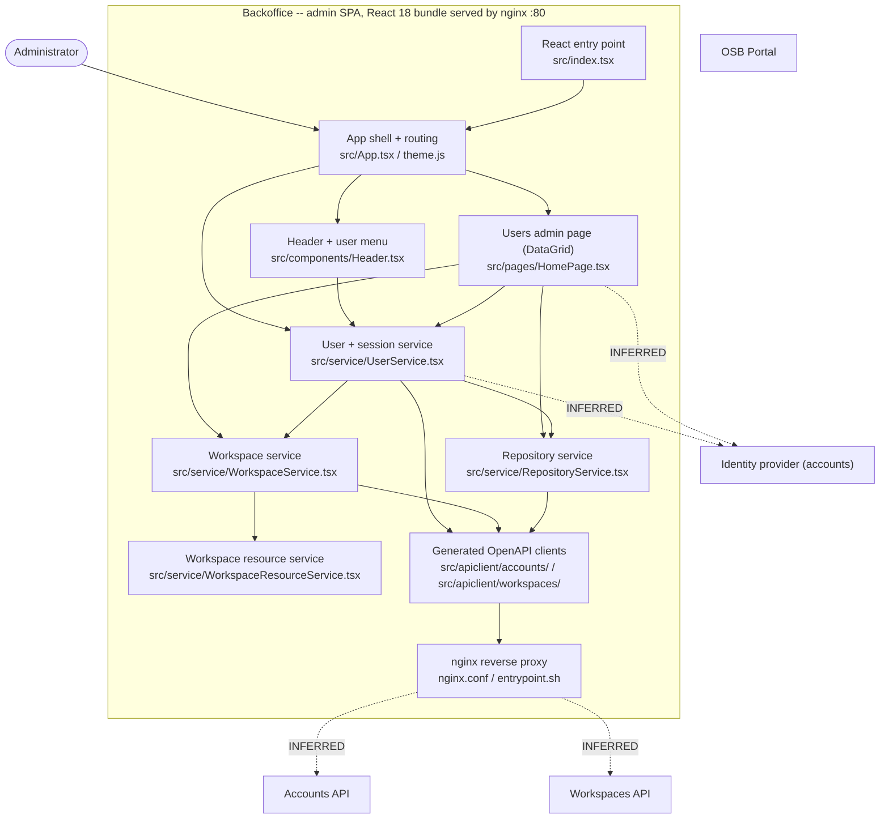

# C4 model: Level 3 -- Component diagram (Backoffice)

Status: architecture documentation. This is the C4 Level 3 view of one container
from the Level 2 model: the **Backoffice** (`backoffice`), the React admin SPA
served by nginx that gives administrators a UI over the Workspaces and Accounts
APIs.  The Level 1 system context is in `c4-level1-osb-context.md`; the Level 2
container diagram is in `c4-level2-osb-containers.md`.

## Scope and intent

A component diagram zooms into a single container and shows the *components* --
the groupings of code behind a clear responsibility -- plus their relationships
to each other and to the containers/external systems already named at Level 2.
Per the C4 standard (https://c4model.com/diagrams/component) these are things
like controllers, services and adapters, not independently deployable units.

Everything inside the `backoffice` boundary is evidenced by the code under
`applications/backoffice/` (`src/`, `nginx.conf`, `entrypoint.sh`): each box maps
to real modules/classes, and each solid relationship corresponds to an import or
call actually present in that code.  Externals are the exact Level 2
identifiers, so this diagram cannot contradict the container model.

The diagram is rendered as a Mermaid `flowchart` with `layout: elk` instead of
Mermaid's `C4Component`, following the convention of the sibling Klea project
and of the Level 1/2/3 files here: Mermaid's C4 diagram types use a fixed
2-column grid with straight `Rel` lines that overlap boxes at this density,
while `elk` routes edges orthogonally around nodes.  This is a
documentation-notation choice, not an architecture decision.

## Component diagram -- Backoffice components (flowchart, elk)



*Notes:* Solid `-->` = an evidenced runtime dependency (an import or call
observed in `applications/backoffice/src/`); dotted `-.->` = a soft or inferred
link.  The dashed links are:

- `nginxProxy -> accountsapi` and `nginxProxy -> wsapi` -- INFERRED: the services
  call the relative base paths `/proxy/accounts-api/api` (`UserService.tsx`) and
  `/proxy/workspaces/api` (`WorkspaceService.tsx`, `RepositoryService.tsx`), so
  the upstream mapping is performed by nginx; the exact `location`/`proxy_pass`
  rules live in `nginx.conf` and were not traced line by line, and Level 2
  already evidences `backoffice -> accountsapi` and `backoffice -> wsapi`, so the
  hop is attributed to the proxy rather than asserted from source.
- `userService -> keycloak` -- INFERRED: login sets `window.location.href =
  "/login"` and logout calls `fetch("/oauth/logout")`; the OpenID Connect
  round-trip is performed by the gatekeeper, and no Keycloak client code exists
  in this repository.  `keycloak-js` is a `package.json` dependency but is never
  imported under `src/`, so no direct browser-to-Keycloak client is claimed.
- `usersPage -> keycloak` -- INFERRED: the profile column builds admin-console
  hyperlinks as `/auth/admin/master/console/#/realms/<realm>/users/<id>` on the
  `getHostname("accounts")` subdomain.  This is user-clicked navigation, and the
  target container is inferred from the Level 2 `accounts` subdomain of the
  identity provider.

Other evidence decisions worth recording:

- `apiClients` collapses everything generated by openapi-generator under
  `src/apiclient/accounts/` and `src/apiclient/workspaces/` (`UsersApi`,
  `GroupsApi`, `InfrastructureApi`, `RestApi`, `K8sApi`, the `models/`
  dataclasses, `runtime.ts` and the `.openapi-generator*` scaffolding) instead of
  being diagrammed file by file.  It is modelled as a component because it is
  where the bearer header is actually injected: `UsersApi.ts` sets
  `Authorization: Bearer ${tokenString}` when
  `configuration.accessToken` is set, and `runtime.ts` exposes that access token
  to every generated call.
- Session state in `userService` is the `kc-access` cookie read and decoded
  client-side (`parseJwt`, `isTokenExpired`) plus an `accessToken` cookie written
  for the downstream proxies; login/logout also use `sessionStorage` to remember
  the post-auth redirect.  The SPA therefore stores nothing server-side and no
  datastore is claimed for this container.
- `workspaceResourceService -> workspaceService` is a reverse dependency: the
  resource service calls the shared `WorkspaceService.workspacesApi` instance and
  the workspace service imports its `mapResource` / `mapPostUrlResource` mappers,
  so the solid arrow points from the service that owns the client to the one that
  borrows it, with a `workspaceService -> workspaceResourceService` import edge
  also recorded.
- `portal` is included as an existing Level 2 node but left unconnected: the
  backoffice is a separate admin SPA and no in-repo link to the portal was found.
- `kubernetes` is deliberately not drawn.  The container is served through
  ingress and secured per Level 2 (`subdomain admin`, `use_services workspaces +
  accounts-api`), but the ingress/probe evidence for this container sits in
  `deploy/values.yaml` and `nginx.conf` and was outside this component pass;
  platform reachability stays captured at Level 2 rather than guessed here.
- Excluded as non-architectural: `src/types/*.ts` (interfaces and enums only),
  `src/utils.ts` (`getBaseDomain`), `src/theme.js`, `src/css/main.less` (2 bytes),
  `src/assets/` and `src/assets-parametrized/` (static `index.html` and
  `keycloak.json` copied by webpack), and `src/components/index.ts` (barrel).
  Build and lint tooling is also excluded: `webpack.common.js`, `webpack.dev.js`,
  `webpack.prod.js`, `tslint.json`, `tsconfig.json`, `openapitools.json`,
  `package-lock.json`.
- No Redux store, no `axios` and no `js-cookie` usage is modelled despite those
  `package.json` dependencies: `src/` never imports them, and the only direct
  network call outside the generated clients is `fetch("/oauth/logout")`.
- `npm test` is the placeholder `echo "Error: no test specified" && exit 1`, so
  there are no tests to model for this container.

## Components

| Component | Module / source | Responsibility |
| --- | --- | --- |
| React entry point | `src/index.tsx` | Mounts the app on `#main` via `createRoot` and renders `<App/>` |
| App shell + routing | `src/App.tsx`, `src/theme.js` | MUI theme/providers, `BrowserRouter` with `/` and `/login` routes, calls `initApis()` |
| Header + user menu | `src/components/Header.tsx` | Shows the signed-in user, sign-in and logout actions |
| Users admin page | `src/pages/HomePage.tsx` | Server-side paged/sorted/searchable user DataGrid with per-user counts and grand totals |
| User + session service | `src/service/UserService.tsx` | Token/cookie session handling, login/logout/redirect, user queries against the Accounts API |
| Workspace service | `src/service/WorkspaceService.tsx` | Workspace fetch/create/update/delete/clone and tags against the Workspaces API |
| Repository service | `src/service/RepositoryService.tsx` | Repository CRUD, contexts/keywords/description and tags against the Workspaces API |
| Workspace resource service | `src/service/WorkspaceResourceService.tsx` | Resource add/open/delete through the shared Workspaces client; resource mappers |
| Generated OpenAPI clients | `src/apiclient/accounts/`, `src/apiclient/workspaces/` | Typed API clients and models; injects the `Authorization: Bearer` header |
| nginx reverse proxy | `nginx.conf`, `entrypoint.sh` | Serves the SPA bundle and terminates the `/proxy/...` paths the services call |

## Build and run

From `applications/backoffice/` the SPA is built and served as follows
(`package.json` scripts):

```bash
npm run start:dev     # webpack dev server against v2dev.opensourcebrain.org
npm run start:local   # dev server against local Accounts/Workspaces APIs
npm run build         # production bundle (webpack.prod.js) into the nginx image
```

The container image copies the built bundle into nginx via `Dockerfile` and
`entrypoint.sh`; `nginx.conf` is the reverse proxy in front of it.

## Rendering

This file follows the same convention as the other levels: the source is the
fenced `mermaid` block above, rendered to a temporary file and not committed.
From the repository root:

```bash
python devdocs/scripts/render_mermaid.py --output-dir /tmp/c4-diagrams --work-dir /tmp/c4-diagrams/src
```
