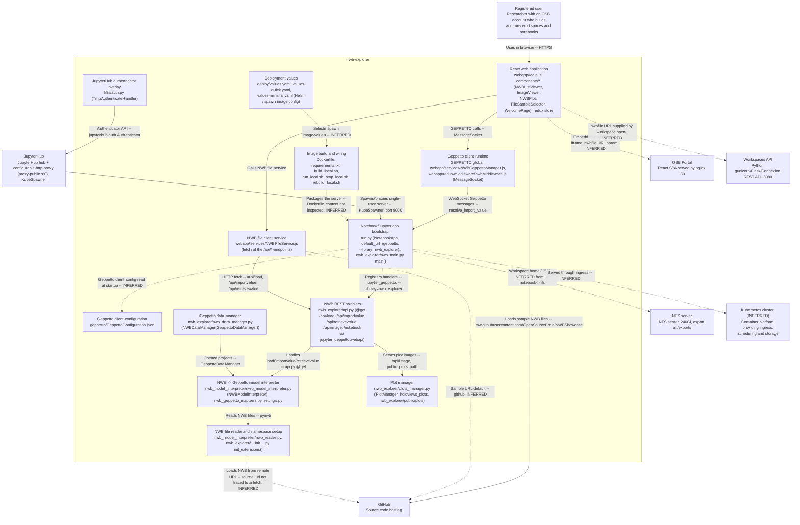

# C4 model: Level 3 -- Component diagram (nwb-explorer)

Status: architecture documentation. This is the C4 Level 3 view of the
`nwb-explorer` application, built from evidence in this repository (the
application's Dockerfile, requirements, deploy values, Geppetto configuration
and the vendored `dependencies/nwb-explorer/` source) rather than from
assumption.  The containers it sits among are in
`c4-level2-osb-containers.md`; the sibling L3 views are
`c4-level3-osb-workspaces-components.md` and
`c4-level3-osb-portal-components.md`.

## Scope and intent

A component diagram zooms into one container from Level 2 and shows the
components inside it and how they collaborate.  Here the container in scope is
`notebook` ("JupyterLab single-user server") in its `nwb-explorer` spawn-image
variant: the OSB-specific NWB Explorer application image.

Note on scope: first-party OSB code in `applications/nwb-explorer/` is thin --
it is OSB packaging (Dockerfile, requirements.txt, `geppetto/GeppettoConfiguration.json`,
`deploy/values*.yaml`, build/run/stop/rebuild/pip_info scripts) wrapped around a
vendored upstream clone at
`applications/nwb-explorer/dependencies/nwb-explorer/` (MetaCell nwb-explorer
0.6.2, carrying its own `.git`), which is the code that actually runs.  The
components therefore follow the vendored package's real modules, not invented
ones.  They are shown inside a single `nwbExplorer` boundary; the Level 2 nodes
they interact with are kept outside it and reuse the Level 2 aliases and labels
verbatim.

The diagram is rendered as a Mermaid `flowchart` with `layout: elk` instead of
Mermaid's `C4Component`, following the convention of the sibling Klea project
and the other OSB L3 diagrams: Mermaid's C4 diagram types use a fixed 2-column
grid with straight `Rel` lines that overlap boxes at this density, while `elk`
routes edges orthogonally around nodes.  This is a documentation-notation
choice, not an architecture decision.

## Component diagram -- nwb-explorer components (flowchart, elk)



*Notes:* Solid `-->` = an evidenced runtime dependency traced to a direct
import, handler registration, `fetch` call or Level 2 edge; dotted `-.->` with
`INFERRED` in its label = an unverified or externally implied link.  The
evidenced edges rest on: `run.py` (NotebookApp, `--library=nwb_explorer`) and
`nwb_explorer/api.py` (`from jupyter_geppetto.webapi import get`, the `/api/*`
handlers); `nwb_model_interpreter/nwb_model_interpreter.py`
(`NWBModelInterpreter`) with `nwb_reader.py`; `nwb_data_manager.py`
(`NWBDataManager(GeppettoDataManager)`); `plots_manager.py` (`public_plots_path`);
`webapp/services/NWBFileService.js` (the `/api/load`, `/api/importvalue`,
`/api/retrievevalue` fetches), `webapp/components/ImageViewer.js` (`api/image`),
`NWBGeppettoManager.js` and `redux/middleware/nwbMiddleware.js`
(`GEPPETTO.MessageSocket.send`); `webapp/components/FileSampleSelector.js` (the
`raw.githubusercontent.com/OpenSourceBrain/NWBShowcase` sample links);
`k8s/auth.py` (`jupyterhub.auth.Authenticator`, `TmpAuthenticateHandler`); and
the Level 2 edges `hub --> notebook` transcribed here as `hub --> notebookApp`.

*Weakest links:* edges 16 to 21 above are the least certain.  The runtime
hand-off from `osb-portal`/`wsapi` to this image is **not** evidenced in code:
it is taken from Level 2 plus the `nwbfile` URL-parameter convention
(`NWBFileService.js`, `const NWB_FILE_URL_PARAM = 'nwbfile'`), and the
`nwbFileService -> github` default link rests only on a commented-out
`NWB_FILE_DEFAULT_URL` constant.  `nwbReader -> github` follows the
`NWBModelInterpreter.__init__(nwb_file_or_filename, source_url=None)` signature,
but no fetch for `source_url` was traced.  `imageBuild -> notebookApp` is
inferred because the Dockerfile content was not inspected; `notebookApp ->
geppettoConfig` because the Geppetto configuration is read at client startup
rather than by a traced server call; `notebookApp -> nfs` and `notebookApp ->
kubernetes` are carried over from Level 2.

*Excluded from the diagram:* `test/`, `test_compatibility.py`,
`utilities/install.py`, `utilities/update.py` and
`k8s/hot_fix_for_eventsource.js` are development/test/tooling artefacts, not
runtime components.  `yarn.lock` and `webapp/package-lock.json` GitHub URLs are
dependency metadata, not edges.  `dandi`, `figshare`, `biomodels`, `smtp`,
`keycloak`, `administrator` and `anonymousVisitor` appear in the Level 2 view
but have no code evidence in this application, so they are deliberately left
unconnected rather than guessed at.

## Rendering the diagram

As with the other OSB C4 diagrams, the source is the fenced `mermaid` block in
this file, so rendering extracts that block to a temporary `.mmd` file in
`/tmp` and renders it there; no rendered image is committed.  From the
repository root:

```bash
python devdocs/scripts/render_mermaid.py --output-dir /tmp/c4-diagrams --work-dir /tmp/c4-diagrams/src --format svg
```

A render is successful when the CLI exits 0; Mermaid parse errors surface
there.  Update this `.md` source and re-run the command above instead of
editing or committing a rendered image.
