# C4 model: Level 3 -- Component diagram (OSB Portal frontend)

Status: architecture documentation. Scope: the `osb-portal` container from `c4-level2-osb-containers.md` (React SPA, Vite build, served by nginx :80), decomposed into its frontend components -- app bootstrap and routing, the shell/page views, the embedded-app iframe bridge, session and auth, the Redux store and middleware, and the API service clients -- with the Level 2 persons, containers and external systems it talks to kept outside the boundary.

## Component diagram -- OSB Portal components (flowchart, elk)

```mermaid
%%{init: {"flowchart": {"layout": "elk", "mergeEdges": false, "nodeSpacing": 40, "rankSpacing": 60}}}%%
flowchart TB

    %% C4 Level 3 - Component diagram for the osb-portal container (OSBv2)
    %% Boundary and external ids/labels are reused verbatim from the Level 2 source
    %%   (devdocs/system/c4-level2-osb-containers.md).
    %% NOTE (a): `authSession` and `accountsClient` share service/UserService.tsx;
    %%   the file is split by responsibility (session/JWT handling vs UsersApi calls).
    %% NOTE (b): WorkspaceService.ensureWorkspaceReady deliberately bypasses the
    %%   generated client for `/workspace/{id}/open` because that operation is not
    %%   in the OpenAPI spec the client is generated from (comment in the file);
    %%   it calls `fetch` directly.
    %% NOTE (c): the embedded application target is resolved dynamically from the
    %%   `application.subdomain` returned by wsapi, so the concrete app images
    %%   (nwb-explorer, netpyne, jupyterlab) are OUT OF SCOPE here; only the
    %%   generic hub / notebook spawn target is drawn.
    %% NOTE (d): applications/osb-portal/out.txt (build log) and the empty test/
    %%   directory have no evidenced runtime role and are NOT modelled.
    %% NOTE (e): dotted edges are INFERRED where no direct call/import was observed
    %%   or where the link is plain browser navigation.

    %% Persons (from Level 1 / Level 2)
    registeredUser["Registered user<br/>Researcher with an OSB account who builds<br/>and runs workspaces and notebooks"]
    anonymousVisitor["Anonymous visitor<br/>Unauthenticated visitor browsing open<br/>workspaces and notebooks"]
    administrator["Administrator<br/>Staff user administering workspaces,<br/>accounts and repositories"]

    subgraph osbPortal ["OSB Portal"]
        direction TB
        appShell["App bootstrap + router<br/>src/index.tsx, src/App.tsx, src/layouts/SidebarLayout.tsx<br/>BrowserRouter/Routes table: /, /workspaces, /workspaces/:id,<br/>/workspaces/open/:id/:app, /repositories, /user/:userName, /login,\nany other path -> NotFoundPage; initApis() on render"]
        shellUI["App chrome + theme<br/>src/header/, src/menu/, src/MainDrawer/, src/dialogs/,<br/>src/common/, src/styled/, src/handlers/OSBErrorBoundary.tsx,\nsrc/theme.js, src/css/"]
        workspacePages["Workspace views<br/>src/pages/WorkspacesPage.tsx, WorkspacePage.tsx,\nWorkspaceOpenPage.tsx; src/components/workspace/*\n(tables, cards, editor, actions menu, add-resource form, drawer/ resource browser)"]
        repositoryPages["Repository views + search/filter<br/>src/pages/Repositories/*, src/pages/RepositoryPage.tsx,\nsrc/components/repository/*, src/types/searchFilter.ts"]
        userPages["User & group admin views<br/>src/pages/UserPage.tsx, src/pages/UserGroupsPage.tsx,\nsrc/components/user/UserEditor.tsx"]
        workspaceFrame["Embedded-app iframe + postMessage bridge<br/>src/components/workspace/WorkspaceFrame.tsx\nbuilds the /hub/spawn/... src, sends LOAD_RESOURCE / NO_RESOURCE,\nvolume-readiness gate before spawn"]
        authSession["Session & auth<br/>src/service/UserService.tsx (kc-access cookie, parseJwt/isTokenExpired,\nlogin, /keycloak.json, /oauth/logout, initApis),\nsrc/components/auth/ProtectedRouter.tsx"]
        store["Redux store<br/>src/store/store.ts, configureStore.ts, rootReducer.ts,\nreducers/workspaces, user, repositories, tags, error, drawer, aboutdialog; actions/*"]
        backendMiddleware["Backend redux middleware<br/>src/middleware/osbbackend.ts"]
        workspaceClient["Workspaces API client<br/>src/service/WorkspaceService.tsx,\nsrc/service/WorkspaceResourceService.tsx"]
        repositoryClient["Repository API client<br/>src/service/RepositoryService.tsx"]
        accountsClient["Accounts API client<br/>src/service/UserService.tsx (UsersApi calls),\nsrc/service/GroupsService.tsx"]
        apiRuntime["Generated OpenAPI clients<br/>src/apiclient/workspaces (runtime, apis, models),\nsrc/apiclient/accounts/*; fetch-based Configuration / BASE_PATH"]
    end

    %% External systems and containers (reused verbatim from Level 2)
    wsapi["Workspaces API<br/>Python gunicorn/Flask/Connexion REST API :8080"]
    accountsapi["Accounts API<br/>Python Flask REST API :8080"]
    keycloak["Identity provider (accounts)<br/>Keycloak identity provider with its own PostgreSQL"]
    hub["JupyterHub<br/>JupyterHub hub + configurable-http-proxy (proxy-public :80), KubeSpawner"]
    github["GitHub<br/>Source code hosting"]
    dandi["DANDI Archive<br/>Neuroscience data archive"]
    figshare["Figshare<br/>Research data repository"]
    biomodels["BioModels (EBI)<br/>Model repository"]
    kubernetes["Kubernetes cluster (INFERRED)<br/>Container platform providing ingress,<br/>scheduling and storage"]

    %% Evidenced relationships (solid)
    registeredUser -->|"Uses -- HTTPS"| appShell
    anonymousVisitor -->|"Uses open workspaces/notebooks -- HTTPS"| appShell

    appShell -->|"reads state -- useSelector(state.error)"| store
    appShell -->|"routes to -- Routes/Route"| workspacePages
    appShell -->|"routes to -- Routes/Route"| repositoryPages
    appShell -->|"routes to -- Routes/Route"| userPages
    appShell -->|"guards routes -- ProtectedRoute"| authSession

    shellUI -->|"read/dispatch state -- useSelector/useDispatch"| store

    workspacePages -->|"read/dispatch state -- useSelector/useDispatch"| store
    repositoryPages -->|"read/dispatch state -- useSelector/useDispatch"| store
    userPages -->|"read/dispatch state -- useSelector/useDispatch"| store

    workspacePages -->|"renders embedded frame -- /workspaces/open/:id/:app"| workspaceFrame
    workspaceFrame -->|"dispatches app messages -- dispatch(message.data)"| store
    workspaceFrame -->|"checks volume readiness before spawn -- /workspace/{id}/open"| workspaceClient
    workspaceFrame -->|"spawns notebook server -- /hub/spawn/<user>/<workspace><type> iframe src"| hub

    workspacePages -->|"calls -- workspaceService"| workspaceClient
    workspacePages -->|"calls -- RepositoryService"| repositoryClient
    repositoryPages -->|"calls -- RepositoryService"| repositoryClient
    userPages -->|"calls -- workspaceService"| workspaceClient

    authSession -->|"propagates token -- initApis(token)"| workspaceClient
    authSession -->|"propagates token -- initApis(token)"| repositoryClient
    authSession -->|"propagates token -- initApis(token)"| accountsClient

    workspaceClient -->|"uses -- workspaceApi.RestApi + Configuration"| apiRuntime
    repositoryClient -->|"uses -- workspaceApi.RestApi + Configuration"| apiRuntime
    accountsClient -->|"uses -- accountsApi.UsersApi/GroupsApi + Configuration"| apiRuntime

    store -->|"registers -- middlewares [loggerMiddleware, osbMiddleware]"| backendMiddleware
    backendMiddleware -->|"calls -- UserService.login()"| authSession

    workspaceClient -->|"calls -- REST, generated client + raw fetch /workspace/{id}/open"| wsapi
    repositoryClient -->|"calls -- REST, generated client"| wsapi
    accountsClient -->|"calls -- REST, UsersApi/GroupsApi"| accountsapi

    repositoryPages -->|"fetches README -- raw.githubusercontent.com rewrite"| github
    repositoryPages -->|"opens repository page -- window.open(repository.uri)"| figshare
    repositoryPages -->|"opens repository page -- window.open(repository.uri)"| biomodels
    repositoryPages -->|"opens repository page -- window.open(repository.uri)"| dandi

    authSession -->|"logout -- /oauth/logout, credentials same-origin"| keycloak

    %% INFERRED relationships (dotted)
    authSession -.->|"INFERRED -- login, cookie session (keycloak-js removed)"| keycloak
    backendMiddleware -.->|"INFERRED -- workspace action proxying"| workspaceClient
    repositoryPages -.->|"INFERRED -- new-workspace link set after create"| workspaceClient
    userPages -.->|"INFERRED -- getUser via UsersApi"| accountsClient
    userPages -.->|"INFERRED -- profile link navigation"| github
    shellUI -.->|"INFERRED -- About/issue link navigation"| github
    administrator -.->|"INFERRED -- user/group admin views exist in the portal source"| userPages
    appShell -.->|"INFERRED -- served through ingress"| kubernetes
```



*Notes:*

*Legend.* Solid `-->` = an evidenced dependency (a direct import, call or selector in the cited source file); dotted `-.->` = INFERRED, i.e. no direct call or import was observed in the source survey, or the link is plain browser navigation rather than integration. Every dotted edge is listed below.

*Assumptions and open points.*

1. `authSession` and `accountsClient` both live in `src/service/UserService.tsx`: the file is split by responsibility (session/JWT handling vs. `UsersApi` calls) rather than by module.
2. `WorkspaceService.ensureWorkspaceReady` bypasses the generated client for `/workspace/{id}/open` because the operation is not exposed by the generated OpenAPI client (noted in the file); it calls `fetch` directly. The `workspaceClient --> wsapi` edge label records this.
3. The embedded application is resolved dynamically from the `application.subdomain` returned by wsapi (`WorkspaceFrame.tsx`), so the concrete application images (nwb-explorer, netpyne, jupyterlab) are OUT OF SCOPE here; only the generic `hub` spawn target is drawn.
4. `applications/osb-portal/out.txt` (a build log) and the empty `test/` directory have no evidenced runtime role and are not modelled.
5. INFERRED edges: `authSession -> keycloak` login -- the component that mints the `kc-access` cookie is outside this repository (`src/utils.ts` records the move from keycloak-js to cookie-based auth); `backendMiddleware -> workspaceClient` -- only the `UserService.login()` call is observed in the middleware; `repositoryPages -> workspaceClient` -- a new-workspace link is set after creation but no direct client import was seen; `userPages -> accountsClient` -- `getUser` through `UsersApi` is only evidenced inside `UserService`; `appShell -> kubernetes` -- served through ingress, carried over from Level 2.
6. `administrator` has no evidenced portal view in the source survey; the Level 2 diagram routes administration through the Backoffice container. The dotted `administrator -> userPages` edge only marks that user/group administration views exist in the portal source.
7. Profile, About and issue-report links (`UserPage.tsx`, `UserGroupsPage.tsx`, `UserEditor.tsx`, `AboutDialog.tsx`, `OSBErrorBoundary.tsx`) are plain browser navigation to GitHub and are drawn dotted; they are not treated as integrations.

## Rendering

From the repository root (extract the fenced Mermaid block to a temporary file and render it there; rendered images are not committed):

```bash
awk '/^```mermaid$/{f=1;next} f&&/^```$/{f=0} f' devdocs/system/c4-level3-osb-portal-components.md > /tmp/c4-level3-osb-portal-components.mmd && mmdc -i /tmp/c4-level3-osb-portal-components.mmd -o /tmp/c4-level3-osb-portal-components.png --scale 2 --backgroundColor transparent
```

A render is successful when the CLI exits 0; Mermaid parse errors surface there.
