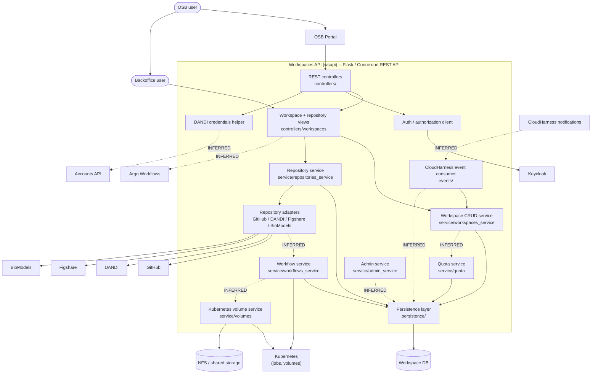

# C4 model: Level 3 -- Component diagram (Workspaces backend)

Status: architecture documentation. This is the C4 Level 3 view of one container
from the Level 2 model: the **Workspaces API** (`wsapi`), the Python
gunicorn/Flask/Connexion REST API that manages workspaces and repositories and
orchestrates copy jobs.  The Level 1 system context is in
`c4-level1-osb-context.md`; the Level 2 container diagram is in
`c4-level2-osb-containers.md`.

## Scope and intent

A component diagram zooms into a single container and shows the *components* --
the groupings of code behind a clear responsibility -- plus their relationships
to each other and to the containers/external systems already named at Level 2.
Per the C4 standard (https://c4model.com/diagrams/component) these are things
like controllers, services and repositories, not independently deployable
units.

Everything inside the `wsapi` boundary is evidenced by the code under
`applications/workspaces/server/workspaces/` (`controllers/`, `service/`,
`persistence/`): each box maps to real modules/classes, and each solid
relationship corresponds to an import or call actually present in that code.
Externals are the exact Level 2 identifiers, so this diagram cannot contradict
the container model.

The diagram is rendered as a Mermaid `flowchart` with `layout: elk` instead of
Mermaid's `C4Component`, following the convention of the sibling Klea project
and of the Level 1/2 files here: Mermaid's C4 diagram types use a fixed
2-column grid with straight `Rel` lines that overlap boxes at this density,
while `elk` routes edges orthogonally around nodes.  This is a
documentation-notation choice, not an architecture decision.

## Component diagram -- Workspaces API components (flowchart, elk)



*Notes:* Solid `-->` = an evidenced runtime dependency (an import or call
observed in `applications/workspaces/server/workspaces/`); dotted `-.->` = a
soft or inferred link.  The dashed links are:

- `notifications -> eventConsumer` -- the CloudHarness events CDC subscription
  on app `workspaces`; the `events` bus itself stays unmodelled per the Level 2
  OUT-OF-SCOPE note.
- `eventConsumer -> persistence` and `adminSvc -> persistence` -- INFERRED: the
  consumer imports only `EventClient`/`current_app`, and `admin_service`'s body
  was not read, but both sit above the same repositories.
- `crudSvc -> quotaSvc`, `workflowSvc -> k8sVolumes` -- INFERRED: no import was
  found either way in the greps; drawn dashed rather than asserted.
- `adapters -> workflowSvc` -- INFERRED: the adapters define
  `create_copy_task`, but the call target was not read.
- `dandiCreds -> accountsapi` -- INFERRED and deliberately ambiguous: user
  attributes may come from the accounts API or from Keycloak directly.
- `crudViews -> argo` -- the `delete_workflow` helper imported from
  CloudHarness `argo_service`, so the target is the Argo boundary rather than an
  internal component.
- `users -> portal` / `users -> backoffice` -- shown only to anchor the people
  from Level 1; they never call the API directly.

Also unresolved by the available evidence: where `quotaSvc` obtains the
per-user limits (CloudHarness configuration versus the accounts API) -- left
unmodelled rather than guessed.

## Rendering

This file follows the same convention as the other two levels: the source is
the fenced `mermaid` block above, rendered to a temporary file and not
committed.  From the repository root:

```bash
awk '/^```mermaid$/{f=1;next} f&&/^```$/{f=0} f' devdocs/system/c4-level3-osb-workspaces-components.md > /tmp/c4-level3-osb-workspaces-components.mmd && mmdc -i /tmp/c4-level3-osb-workspaces-components.mmd -o /tmp/c4-level3-osb-workspaces-components.svg --scale 2 --backgroundColor transparent
```
